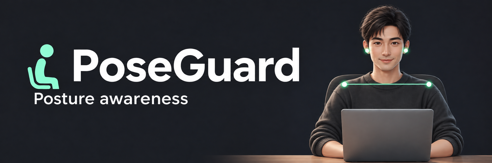
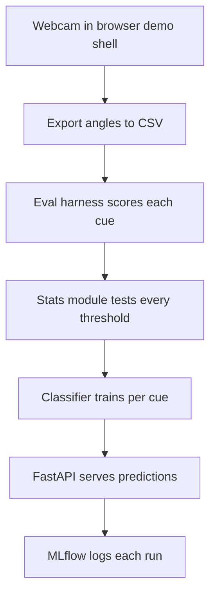

# PoseGuard

PoseGuard is a Python, AI, and ML project that tests whether webcam posture cues can be measured honestly. It collects real webcam landmark data, evaluates two posture cues against that data with pandas, validates them with statistics, trains scikit-learn and PyTorch classifiers on them, and serves the result behind FastAPI, with MLflow tracking and Docker packaging. A small React app acts as the demo shell that collects the webcam data in the first place.

The headline result is not a success story. The classifier does not beat the simple rule baseline on either cue yet, and the report below says exactly why. The value of the project is the evaluation: a full pipeline that can tell a real signal from a fake one, on real data, with numbers.

**Status:** Built through Day 19. The Python pipeline is complete and tested (286/286 tests). The honest headline has not changed since Day 3: **nothing passes the gate**. The best rule catches 4/5 shoulder trials with 8 false positives; the best head rule catches 2/5 with 3 false positives; no model beats the rule baseline on either cue. Day 18 ships the public Streamlit demo that shows all of this, and Day 19 turns it into a real app: a live webcam check (streamlit-webrtc video, snapshot fallback), a purpose and how-to-use section, and a feedback link to GitHub issues. The live API URL still needs his Render or AWS clicks (guides in `docs/DEPLOY.md` and `docs/DEPLOY_AWS.md`), and the real re-benchmark still waits on his camera re-run capture (Day 14 tool, Day 16 harness ready).

## What this project is

Most posture apps start with the camera and the reminder. PoseGuard started there too, then the data took over. A validation run on a real laptop produced a CSV of about 7,820 frames, and everything since has been about what that CSV actually proves.

The pipeline, in order:

1. **Collect:** the React demo shell runs MediaPipe pose landmarks in the browser and exports the angles to CSV.
2. **Evaluate:** a pandas harness (`experiments/eval/`) scores each cue against the CSV, with circular angle math that handles the plus/minus 180 degree wraparound.
3. **Validate:** a statistics module (`experiments/eval/stats.py`) asks whether any threshold or persistence rule could make a cue pass, using Wilson confidence intervals, false-positive rates, and threshold/persistence curves.
4. **Learn:** a scikit-learn classifier (`experiments/model/`) trains one model per cue on 1-second windows of angle data, with grouped cross-validation by trial.
5. **Serve:** FastAPI (`GET /health`, `POST /predict`) serves the trained models and applies the 5-second persistence gate over a trailing history.
6. **Track:** MLflow logs every training run to a local file store so runs can be compared instead of overwritten.
7. **Package:** a Dockerfile and docker-compose file wrap the API and the MLflow UI.

## The two cues, and the honest verdict

The MVP tracks two cues only. A reminder fires when a deviation persists for five continuous seconds, and the timer resets on tracking loss.

| Cue | What it measures | Verdict |
| --- | --- | --- |
| Head tilt | Angle of the ear line relative to the shoulder line, vs calibration | Salvageable. The tilts were real but too brief for the 5-second rule. The re-run needs longer, deeper holds. |
| Shoulder tilt | Angle of the shoulder line relative to the image horizontal, vs calibration | The metric is wrong for desk work. Leaning while typing looks identical to a dropped shoulder, and no threshold or persistence rule fixes it. Day 5 needs a different signal. |

The engineering gate is at least 4 of 5 deliberate holds detected per cue, with zero reminders during a five-minute ordinary-work sample. Neither cue passes it yet.

## Results on Run 1 (Nov 3, 2026)

Run 1 is one session on a real laptop: 5 head holds, 5 shoulder holds, about 5 minutes of ordinary desk work, and a landmark-loss test that never really ran (tracking was lost for only 18 of 1,828 frames). Baselines: head -5.6 degrees, shoulder 174.2 degrees. Full numbers are in [experiments/eval/REPORT.md](experiments/eval/REPORT.md); the plain-English walkthrough is in [experiments/eval/WALKTHROUGH.md](experiments/eval/WALKTHROUGH.md).

### Rule baseline (Day 3 and Day 4)

- Head tilt: **0/5 at every threshold (5, 6, 7, 8 degrees)**. Longest run above 5 degrees was 1.53s vs 5s required. Zero false positives.
- Shoulder tilt: **0/5 at every threshold, plus 7 false positives during ordinary work**, about 83 per hour of desk work.
- The wraparound bug was real and is fixed: the old linear math produced phantom deviations beyond 180 degrees in 1,188 shoulder frames. Circular math (`atan2(sin(a-b), cos(a-b))`) removes all of them, but it does not fix the shoulder cue.
- Wilson 95% interval on head detection (0/5) is 0 to 43%, far below the 80% gate. This is not bad luck on a small sample.

### Classifier (Day 5, out-of-fold, grouped 5-fold CV by trial)

The classifier does **not** beat the rule baseline on either cue. No decision threshold passes the gate (4/5 trials, 0 false positives) for either cue.

| Cue | Model | Accuracy | F1 (tilted) | Trials | False positives |
| --- | --- | --- | --- | --- | --- |
| Head | Logistic regression | 0.446 | 0.078 | 1/5 | 6 events |
| Shoulder | Logistic regression | 0.548 | 0.179 | 5/5 | 5 events, 134 of 318 work windows flagged |

The shoulder 5/5 is a stillness artifact. During holds you sit still; during work the tracker is noisy, so the model learned "steady equals tilted". On calm windows only, accuracy drops to about 0.45. The head model learned the relationship backwards: a flat upright window scores 0.56 tilted while a steady 6-degree tilt scores 0.33, because in Run 1 the biggest head deviations happened during noisy desk work, not during holds.

Root causes: one session, 23 tilted vs 360 upright windows, and protocol labels that are not ground truth (two of the five head holds barely tilted at all). The fix is re-run data, not a fancier model.

### MLflow comparison (Day 6)

| Run | Head trials | Shoulder trials | F1 head | F1 shoulder | Accuracy |
| --- | --- | --- | --- | --- | --- |
| Baseline (best model per cue) | 1/5 | 5/5 | 0.078 | 0.179 | 0.446 / 0.548 |
| Random forest only | 0/5 | 0/5 | 0.000 | 0.000 | about 0.93 |

The random forest hit about 93% accuracy by learning to always answer "upright". Accuracy lies on imbalanced data; F1 is the honest score. Neither model beats the rule baseline.

### Best results as of Day 18

After the Day 15 head rework, the Day 17 shoulder rework, and the Day 11 gated shoulder signal, this is the best any candidate does on Run 1. The gate is 4/5 trials with zero false positives.

| Cue | Best rule | Best model |
| --- | --- | --- |
| Head | 4 deg / 2 s / 10 deg/s cap: 2/5 trials, 3 false positives, F1 0.400 | MLP F1 0.105 (2/5 trials, 3 FP) |
| Shoulder | 1 deg / 5 s / 5 deg/s cap: 4/5 trials, 8 false positives, F1 0.471 | LR / MLP F1 0.172 (3/5 trials); RF 0/5 |

The shoulder grid reaches the detection half of the gate but never the false-positive half, and the velocity and dwell features made both models worse, not better. The served v2 models (Day 13) are unchanged because nothing better exists to serve. Full numbers are in `experiments/model/BENCHMARK.md`, `results_day15.json`, and `results_day17.json`; the public demo in `demo/` shows the same numbers.

## How it works



The demo shell estimates body landmarks locally with a pretrained pose model (MediaPipe Pose Landmarker Lite, CPU delegate). Simple geometry compares those points with a calibrated reference position, about a 3-second calibration. When required landmarks are not visible or confidence is too low, posture evaluation pauses and the reminder timer resets.

Forward neck flexion, slouch, and medical assessment are out of scope. Feedback describes deviation from a reference position; it is not a medical assessment or a validated health score.

## Tech stack

**Python, data, and ML (the headline):**

- **Evaluation:** pandas, numpy, pytest. Circular angle math, CSV loading and schema validation, trial analysis, threshold sensitivity, Wilson intervals.
- **Modeling:** scikit-learn (logistic regression, 200-tree random forest), grouped cross-validation by trial, 1-second feature windows.
- **Serving:** FastAPI, uvicorn, joblib model artifacts (about 2 KB each).
- **Tracking:** MLflow, local file store.
- **Packaging:** Docker, docker-compose.

**Demo shell (React, not the headline):**

- **Frontend:** React 19 + TypeScript, Vite.
- **Pose estimation:** MediaPipe Tasks Vision, Pose Landmarker Lite, CPU delegate.
- **Camera:** browser `getUserMedia`, frame capture in a Web Worker with OffscreenCanvas, one frame in flight at a time.
- **Visual feedback:** Canvas 2D landmarks and skeleton overlay, Web Audio chimes, IndexedDB session summaries.

## Project layout

```
.
├── README.md
├── PRD.md                        # MVP requirements and acceptance criteria
├── demo/                         # Day 18 public Streamlit showcase
│   ├── app.py                    # Streamlit UI: charts, gate verdicts, scoreboard
│   ├── demo_data.py              # pure data/verdict logic (tested, no Streamlit import)
│   ├── data/run1_sample.csv      # 727-row 1 Hz sample of the Run 1 session
│   ├── requirements.txt
│   └── README.md
├── experiments/
│   ├── eval/                     # Python eval harness (Days 3-4)
│   │   ├── circular.py           # wraparound-safe angle math
│   │   ├── loader.py             # CSV loading and schema validation
│   │   ├── analysis.py           # trial detection, false positives
│   │   ├── stats.py              # Wilson intervals, threshold/persistence curves
│   │   ├── report.py             # Markdown report generator
│   │   ├── cli.py                # python -m experiments.eval.cli
│   │   ├── rerun_protocol.py     # Run 2 protocol: timings, targets, timelines
│   │   ├── rerun.py              # Run 2 CSV validator
│   │   ├── REPORT.md             # full Run 1 numbers
│   │   └── WALKTHROUGH.md        # plain-English version
│   ├── model/                    # scikit-learn classifier + API (Days 5-6)
│   │   ├── features.py           # 1-second window features
│   │   ├── train.py              # per-cue training, grouped CV
│   │   ├── api.py                # FastAPI: GET /health, POST /predict
│   │   ├── tracking.py           # MLflow logging and comparison
│   │   ├── artifacts/            # Day 5 trained models (model_head.joblib, model_shoulder.joblib)
  │   ├── artifacts_v2/         # Day 13 served models (gated features)
│   │   ├── Dockerfile
│   │   └── docker-compose.yml    # API on 8000, MLflow UI on 5000
│   ├── webcam-validation-experiment.html   # data collection page (serve locally, see below)
│   ├── rerun-capture.html        # Run 2 data collection page (serve locally, see below)
│   └── WALKTHROUGH_DAY14.md      # Day 14 walkthrough
├── src/                          # React demo shell (Days 1-2)
│   ├── posture/angles.ts         # angle math and EMA smoothing
│   └── camera/                   # getUserMedia, worker capture, stats
└── docs/validation.md            # validation gate definition
```

## Setup and usage

### Python pipeline

Python 3.11 or later.

```bash
python3 -m venv ~/.venv-poseguard-eval
~/.venv-poseguard-eval/bin/pip install -r experiments/eval/requirements.txt
```

Run the eval harness on a validation CSV (from the repo root):

```bash
python -m experiments.eval.cli --csv <path/to/validation.csv>
python -m experiments.eval.cli --csv <path> --out experiments/eval/REPORT.md
```

It prints per-cue verdicts (PASS/FAIL vs 4/5 detections and zero false positives) plus the threshold sensitivity table, and writes the full Markdown report.

Train the classifier:

```bash
python -m experiments.model.train --csv <path/to/validation.csv>
python -m experiments.model.train --csv <path> --save
python -m experiments.model.train --csv <path> --model random_forest --mlflow --run-name random_forest_only
```

`--save` writes the winning model per cue to `experiments/model/artifacts/` and the full metrics to `results.json`. Day 13 serves from `artifacts_v2/` instead; `--artifacts-dir` aims a save at another directory. `--mlflow` logs the run to the local file store instead of overwriting `results.json`. Compare runs with `python -m experiments.model.tracking` (writes `mlflow_comparison.json`), or browse them with:

```bash
mlflow ui --backend-store-uri experiments/model/mlruns
```

Serve the API:

```bash
uvicorn experiments.model.api:app --port 8000
```

Run the tests (286/286 in one combined run: 80 eval + 206 model):

```bash
python -m pytest experiments/ -q
```

### Public demo (Streamlit, Day 19)

The demo shows the real Run 1 session, not a simulation: sample angle charts, gate verdicts per trial, and the LR / RF / MLP scoreboard, with the honest nothing-passes verdict as the headline. Day 19 adds a live webcam check (streamlit-webrtc video with a snapshot fallback), a purpose and how-to-use section, and a feedback link to GitHub issues.

```bash
pip install -r demo/requirements.txt
streamlit run demo/app.py
```

Free deploy on Streamlit Community Cloud with main file `demo/app.py`. See `demo/README.md`.

**Live demo:** https://dasarijashwanth-poseguard-demoapp-7dxpwy.streamlit.app/

### Docker

Build from the repo root (the build context):

```bash
docker build -f experiments/model/Dockerfile -t poseguard-api .
docker run -p 8000:8000 poseguard-api
```

Or run the API plus the MLflow UI together (from `experiments/model/`):

```bash
docker compose up --build
```

API on http://localhost:8000, MLflow UI on http://localhost:5000. The image already contains the trained models; mounting `./artifacts_v2` over `/app/experiments/model/artifacts_v2` serves a freshly retrained model without rebuilding.

Honest limit: Docker is not installed on the build machine, so the image was checked by tests, not by a real build. There is no live URL for the API yet.

### Demo shell (React)

```bash
npm install
npm test        # Vitest
npm run build   # type-check + production build
npm run dev     # Vite dev server
```

To collect validation data, serve `experiments/webcam-validation-experiment.html` from localhost, not from a hosted page, because the browser blocks camera access on hosted artifact pages. The working route is a local static server on port 8000, then open `http://localhost:8000/experiments/webcam-validation-experiment.html`. The page has adjustable thresholds (head default 8 degrees, shoulder default 6) and exports the session as CSV.

## Privacy and limitations

- All frame processing happens locally in the browser. No camera images are recorded or uploaded. Only angle numbers leave the page, as a CSV you export yourself.
- No accounts, no cloud database, no LLM in the loop.
- Detection depends on camera angle, lighting, clothing, and body visibility. A laptop webcam may not show the hips or reliably distinguish forward slouching.
- Everything above rests on one validation session (Run 1, Nov 3, 2026). One session, five holds per cue, is too little data to train on or to generalize from. The re-run is the next data point, not a victory lap.

## Build Progress

### Day 15 (Nov 17): head cue rework

- Day 13 left the head cue as the worst half of the served model (logistic regression 1/5 trials, 6 false positives, F1 0.078), and Day 4 said the tilts were real but too brief for the 5 s gate. Day 15 separates the three things that claim conflates: the level (thresholds 4-8 deg), the persistence (2/3/5 s), and the speed of the head line (velocity cap none / 5 / 10 / 20 deg/s, where a fast frame breaks a persistence run). Every one of the 60 configurations is scored the same way: trials detected, work false positives, and trial-level F1. Head only; the shoulder cue is untouched.
- The holds are shallow as well as brief: the deepest hold peaks at 7.1 deg (against an 8 deg session threshold no hold ever reaches) and the longest run above 4 deg inside any hold is 2.2 s, while ordinary work contains head excursions of 10-18 deg sustained for 2-4 s. Trial 5 is barely recorded (6 frames), so at most 4/5 trials are measurable in Run 1. Best rule configuration is 4 deg, 2 s, 10 deg/s cap: 2/5 trials, 3 false positives, F1 0.400. The velocity cap does real work on false positives (9 to 3 at 4 deg / 2 s) but cannot create detections the holds never earned.
- Two new head features (`experiments/model/features.py`): vel_h, mean speed of the head line in deg/s, and dwell_h, longest continuous run above 5 deg in seconds. Same grouped 5-fold CV as Days 8/12: LR F1 0.078 to 0.097 (1/5 to 2/5 trials, 6 to 4 FP), MLP 0.060 to 0.105 (1/5 to 2/5, 4 to 3 FP), RF still 0/5. The MLP's calm-only accuracy slips 0.685 to 0.605 and the new LR coefficients contradict each other (fraction-above-5 +1.468, dwell -0.962), so the small gains lean on noise, not signal. The served v2 artifacts are unchanged: nothing better to serve. Day 4's story needs correcting: dwell separates in the wrong direction, work dwells longer than the holds do. The fix is still the camera re-run with raw landmarks and longer, deeper holds (Day 14 tool).
- 194/194 tests passing in one combined run (71 eval + 123 model, including 28 new Day 15 tests). Full numbers in `experiments/model/WALKTHROUGH_DAY15.md` and `experiments/model/results_day15.json`.

### Day 19 (Nov 21): the demo becomes a real app

- The Day 18 showcase was static, so Day 19 makes it a real app in the three parts he picked: (a) a live webcam check in `demo/app.py` with pure angle/gate logic in `demo/webcam.py`, (b) a purpose and how-to-use section at the top of the page, (c) a feedback section linking to GitHub issues.
- Live video runs through streamlit-webrtc with MediaPipe PoseLandmarker (VIDEO mode), annotated frames and live angle readouts, calibrate upright then hold 5 s to fire the gate. If the video stream cannot start, the snapshot check (st.camera_input, IMAGE mode) does the same job one photo at a time. Two gate presets: operating thresholds (head 8 deg / shoulder 6 deg, 5 s) and the best rule-grid configs (head 4 deg / 2 s, shoulder 1 deg / 5 s), so visitors can see why the best configs fail. No video leaves the browser; only angles are kept. The lite landmarker model is bundled (`demo/pose_landmarker_lite.task`, 5.8 MB) and `.streamlit/config.toml` turns websocket compression off for the video stream on Community Cloud.
- Two things found while building: mediapipe 1.x removed the legacy `mp.solutions.pose` API, so the app uses the supported Tasks Vision API; and MediaPipe Tasks needs system GL libraries (`libegl1`, `libgles2`), which this VM lacked and the Cloud image already carries.
- The numbers are unchanged: best shoulder rule 4/5 trials with 8 false positives (F1 0.471), best head rule 2/5 with 3 false positives (F1 0.400), best models F1 0.172 shoulder and 0.105 head. Nothing passes the gate, and the live check is the same gate running on the visitor's own camera.
- 286/286 tests passing in one combined run (80 eval + 206 model, including 28 new Day 19 tests). Full numbers in `experiments/model/WALKTHROUGH_DAY19.md`.

### Day 18 (Nov 20): Streamlit public demo showcase

- The project had no public face, so Day 18 ships one: a Streamlit app (`demo/app.py`, free deploy on Streamlit Community Cloud) showing the real Run 1 session, not a simulation. Sample angle charts at 1 Hz (`demo/data/run1_sample.csv`, 727 rows), gate verdicts per trial, and the LR / RF / MLP scoreboard, with the honest verdict as the headline.
- The numbers are the same as Days 15/17: best shoulder rule 4/5 trials with 8 false positives (F1 0.471), best head rule 2/5 with 3 false positives (F1 0.400), best models F1 0.172 shoulder and 0.105 head, random forest 0/5 on both cues. Nothing passes the gate, and the demo says so instead of hiding it.
- Building the sample surfaced a 6-second tracker meltdown at 447 s mid-work (head -94.95 deg, shoulder +141.74 deg); the chart clips its axis at +/-25 deg and discloses the meltdown rather than deleting it.
- 258/258 tests passing in one combined run (80 eval + 178 model, including 19 new Day 18 tests). Full numbers in `experiments/model/WALKTHROUGH_DAY18.md`.

### Day 17 (Nov 19): shoulder cue rework

- Day 11 left the shoulder cue with the tracker-noise half fixed (the jump-gated signal cuts false positives from 7 to 1 at the 6 deg operating threshold) but the level half untouched: the gated signal still detects 0/5 trials there, because a deliberate hold moves the shoulder line only about 2.5 deg while everyday leaning drifts 4-7 deg. Day 17 gives the shoulder cue the Day 15 treatment: a threshold (1-8 deg) x persistence (2/3/5 s) x velocity-cap (none / 5 / 10 / 20 deg/s) grid, 72 configurations, each scored on trials detected, work false positives, and trial-level F1, plus velocity (vel_s) and dwell (dwell_s, above 2 deg) features and an LR / RF / MLP comparison on the old 11 vs new 13 shoulder features, same grouped 5-fold CV as Days 8/12/15.
- The grid reaches the detection half of the gate but never the false-positive half: 16 configurations detect 4/5 or 5/5 trials, all at 1-2 deg, and the cheapest still carries 8 false positives. Best is 1 deg / 5 s / 5 deg/s cap at 4/5 trials, 8 false positives, F1 0.471. The velocity cap does real work (at 1 deg / 5 s it cuts false positives from 19 to 8), but 8 is still 8, and at the 6 deg operating threshold the grid reproduces Day 3/4 exactly, 0/5 trials with 7 false positives. The shoulder alignment is inferred, not verified (Run 1 recorded no shoulder trial summary), and trial 5 is barely recorded (8 samples), so at most 4/5 trials are measurable; trial 3 carries a 58 deg tracker spike inside the hold itself.
- The new features make the models worse, not better: logistic regression drops from 5/5 trials to 3/5 and F1 0.219 to 0.172, the MLP from 4/5 to 3/5 with F1 0.215 to 0.172, 4 false positives, 123 of 318 work windows flagged, and calm-only accuracy 0.638 to 0.524. The coefficients contradict the story the features were built to tell (vel_s -0.475, dwell_s -0.328), and the gated coefficients stay negative, so the stillness artifact is still doing the work. The random forest ignores the new features and still detects nothing. The served v2 artifacts are unchanged: nothing better to serve. The fix is still the camera re-run with raw landmarks and longer, deeper holds (Day 14 tool).
- 239/239 tests passing in one combined run (80 eval + 159 model, including 28 new Day 17 tests). Full numbers in `experiments/model/WALKTHROUGH_DAY17.md` and `experiments/model/results_day17.json`.

### Day 16 (Nov 18): Run 2 re-benchmark harness

- The user's capture run has not arrived yet, so Day 16 is the harness that will run on it: `python -m experiments.model.day16 --csv <capture.csv> [--manifest <manifest.json>]` validates the file with `experiments/eval/rerun` (exit 2 with a clear error on a bad file or a mismatched manifest), then re-runs the Day 15 head grid and model comparison and the Day 11/12 shoulder signal and model comparison, all with the Run 2 protocol timings (5 s ready, 10 s hold, 5 s rest) and rule baselines counted on the new data (head 15 deg / 5 s, shoulder old level at 8 deg / 5 s).
- The real work was in the shared evaluation: every function hardcoded the Run 1 trial timings (3/6/3, 12 s cycle), which would drift a full trial out of phase by the second hold on Run 2 data. `analysis.py`, `head.py`, `signals.py`, and `features.py` now take the protocol timings as keyword arguments (Run 1 defaults, so Days 3-15 are unchanged). Pinned by test: Run 1 timings label 30 tilted windows on the fixture, Run 2 timings label the correct 45.
- On the synthetic fixture (clean holds to target depth, flat work, 5150 frames, 98.1% tracked, no validator warnings) the gate passes by construction: head grid best 4 deg / 5 s / no cap at 5/5 with 0 false positives, all six head model rows perfect, shoulder gated signal best 1 deg at 5/5 with 0 false positives. The fixture also reproduces the honest shoulder story: old-feature LR flags all 300 work windows (F1 0.173) while the gated-feature LR (F1 0.889) and RF (F1 1.0) pass. The verdict function names every pass and reports "nothing passes the gate" on fabricated failing numbers.
- 211/211 tests passing in one combined run (71 eval + 140 model, including 17 new Day 16 tests). Full numbers in `experiments/model/WALKTHROUGH_DAY16.md` and `experiments/model/results_day16.json` (labeled as a synthetic fixture, not a real capture).

### Day 14 (Nov 16): camera re-run capture tool

- Day 13 closed with the served models still failing the gate because the signal itself is the problem: holds move the shoulder angle only about 2.5 deg vs 4-7 deg of drift, and the Run 1 CSV has no raw landmarks. Day 14 builds the fix: `experiments/rerun-capture.html`, a standalone capture tool that records all 33 pose landmarks per frame, with 10 s holds (was 6 s), 5 s ready/rest (was 3 s), and live depth targets (shoulder 8 deg, head 15 deg) shown while holding. Tracking requires hips 23/24 visible, so the shoulder-vs-hip signal Run 1 could not test is in the data.
- The tool guides the full session (calibration 5 s, 5 head trials, 5 shoulder trials, 5 min work sample, 10 s landmark-loss test, about 8.6 min), labels every frame with cue, hold id and phase, and downloads a CSV that is a superset of the Run 1 schema (the existing loader reads it unchanged) plus a JSON manifest with per-hold stats and tracking-loss gaps. It runs from localhost via a PowerShell Net.HttpListener block printed on the page; nothing is installed on his laptop.
- `experiments/eval/rerun_protocol.py` holds the protocol as the single source of truth, and `experiments/eval/rerun.py` validates a captured CSV before the Day 15 re-benchmark uses it (schema errors fail the file; weak holds, short work samples and tracking gaps warn). No captured data was invented; the capture itself is the next step.
- 166/166 tests passing in one combined run (60 eval + 106 model, including 16 new Day 14 tests). Full numbers in `experiments/WALKTHROUGH_DAY14.md`.

### Day 13 (Nov 15): serve the gated models in the API

- The API served the Day 5 models with no way to run the 5-second persistence gate. Day 13 retrains the serving models on the gated features into `experiments/model/artifacts_v2/` (head logistic regression on its 6 features, shoulder logistic regression on the new 11), reproducing the Day 12 numbers exactly (shoulder LR F1 0.219, 5/5 trials, 3 false positives; head LR F1 0.078, 1/5 trials, 6 false positives). The pick is logistic regression for both cues, on the gate numbers: shoulder LR is 5/5 trials against MLP 4/5 and RF 0/5. The Day 5 artifacts in `artifacts/` are untouched.
- `POST /predict` gains an optional `gate_s` (0 to 10 seconds): with `gate_s=5` it scores every full 1-second window in the request and answers "tilted" only when the last 5 are all tilted; a "lost" window resets the run. The response carries `gated`, `gate_s`, `windows`, and `consecutive_tilted_windows`. With `gate_s=0` the last window decides, exactly as before. Each window is smoothed and gated on its own second of samples (the Day 5 contract); the first attempt smoothed over the whole request and a Day 5 test caught it.
- The served models still do not pass the gate (4/5 trials, 0 false positives): the shoulder LR clears the trials half at 5/5 but has 3 false positives, and its gated coefficients stay negative, so it still rides the stillness artifact. The gate itself is verified end to end: the real v2 shoulder model on a real 5-second Run 1 hold scores all five windows tilted and the gate fires, while a 2-second tilt does not.
- 150/150 tests passing in one combined run (44 eval + 106 model, including 27 new Day 13 tests). Full numbers in `experiments/model/WALKTHROUGH_DAY13.md` and `experiments/model/results_day13.json`.

### Day 12 (Nov 14): RF + MLP benchmark on the new gated signal

- Day 11 showed logistic regression improving on the gated features. Day 12 runs the other two models, random forest and MLP, on both feature sets (old 8 vs new 11) for both cues, same grouped 5-fold CV by trial as Day 8. The old-feature rows reproduce Day 8 exactly, every number.
- Shoulder, new features: MLP F1 0.133 to 0.215, recall 0.241 to 0.552, trials 2/5 to 4/5, but false positives 1 to 3 and work flagged 54 to 82, calm-only accuracy 0.663 to 0.638. The forest still detects 0/5 with F1 0.000, even though the gated features take 45 percent of its importance. Logistic regression is unchanged from Day 11 (F1 0.219, 5/5, 3 FP), and its gated coefficients stay negative, so the stillness artifact persists. Head is identical old vs new, as expected. No model passes the gate on either feature set.
- 123/123 tests passing in one combined run (44 eval + 79 model, including 8 new Day 12 tests). Full numbers in `experiments/model/WALKTHROUGH_DAY12.md`, `experiments/model/BENCHMARK.md`, and `experiments/model/benchmark.json`.

### Day 11 (Nov 13): New shoulder signal

- The Run 1 CSV holds only two angle columns, no raw landmarks, so the planned shoulder-vs-hip and shoulder-height-asymmetry candidates are impossible from this data; the re-run must record raw landmarks. Three angle-only candidates were built and tested in `experiments/eval/signals.py`: rolling-baseline deviation, shoulder-minus-head relative deviation, and a jump-gated deviation that only counts frames the tracker did not jump on.
- Winner is the gated signal: at the 6 degree operating threshold it cuts false positives from 7 to 1 (0 at 8 degrees), but it still detects 0/5 trials there, so no candidate passes the gate (4/5 trials, 0 false positives). The gate fixes the tracker-noise half, not the level half: deliberate holds move about 2.5 degrees while ordinary work drifts 4 to 7.
- Wired into the model as three new gated features; logistic regression on the shoulder cue improves on every metric (F1 0.179 to 0.219, false positives 5 to 3, work windows flagged 134 to 109, calm-only accuracy 0.447 to 0.585), but the coefficients are negative on the gated features, so the model is still riding the Day 5 stillness artifact (holds are quiet, not tilted). The live API still serves the Day 5 models; artifacts were not retrained.
- 115/115 tests passing in one combined run (44 eval + 71 model, including 16 new Day 11 tests). Full numbers in `experiments/model/WALKTHROUGH_DAY11.md` and `experiments/model/day11_comparison.json`.

### Day 10 (Nov 12): AWS deploy prep

- ECS Fargate deploy prep in `deploy/aws/`: a task definition (`poseguard-api`, smallest Fargate size 0.25 vCPU / 0.5 GB, port 8000, health check on `/health`, CloudWatch logs), a service definition (desired count 1, behind an Application Load Balancer), and a deploy script that builds the same slim Day 9 image, pushes it to ECR, backs the trained model artifacts up to S3, registers the task definition, and creates or updates the service.
- Deploy guide (`docs/DEPLOY_AWS.md`): exact console steps and the deploy command, cost about $25 a month (about $9 for the task, about $16 for the load balancer), and the resume bullet this closes (AWS was the top skills gap, 11 postings).
- 99/99 tests passing in one combined run (33 eval + 66 model, including 12 new AWS tests). Still unverified: the deploy script has never been run end to end (no Docker on the build machine, no AWS account confirmed), and there is no live URL until the AWS steps run.

### Day 9 (Nov 10): Render deploy prep

- Render Blueprint (`render.yaml` at the repo root): one web service, `poseguard-api`, Docker runtime, free plan, health check on `/health`. No secrets needed, the image already contains the trained models and the API takes no API keys.
- Two real deploy blockers fixed in the Dockerfile: the start command now binds `$PORT`, which Render sets (10000 by default, not 8000), and the image now installs a slim runtime-only requirements file (`experiments/model/requirements-api.txt`), because the old file pulled torch and mlflow and the default torch install is the multi-gigabyte CUDA build. The MLflow service in docker-compose still gets the full requirements through a build arg.
- Deploy guide (`docs/DEPLOY.md`): exact click-by-click Render steps, free-tier notes, and a manual fallback.
- Verified live locally: the API started on a Render-style port with uvicorn, `/health` answered 200 with both models loaded, `/predict` answered 200 for both cues, and a bad cue answered 422.
- 87/87 tests passing in one combined run (33 eval + 54 model, including 9 MLP, 8 Docker, 5 Render). Still unverified: no real Docker build has ever run, Docker is not installed on the build machine, and there is no live URL until the Render steps run.

### Day 8 (Nov 10): PyTorch MLP benchmark

- Small PyTorch MLP per cue (`experiments/model/torch_mlp.py`): two hidden layers (32, 16), ReLU, dropout, Adam with weight decay, early stopping on a validation split taken from the training groups only, inverse-frequency class weights computed from the training portion only. CPU-only, deterministic at a fixed seed. Torch 2.15.0+cpu installed in the eval venv.
- Benchmark (`experiments/model/benchmark.py`, `BENCHMARK.md`): MLP vs logistic regression vs random forest on the same Run 1 data, same grouped 5-fold CV by trial. Honest verdict: the MLP does not beat logistic regression on either cue (head F1 0.060 vs 0.078, shoulder 0.133 vs 0.179) and passes the gate on neither (head 1/5 trials, 4 FP; shoulder 2/5 trials, 1 FP). It is the least trigger-happy model and the only one whose signal survives the calm-only check (accuracy 0.685/0.663 vs 0.427/0.447). At threshold 0.3 the head MLP reaches 4/5 trials with 2 FP, the closest any model has come to the gate. The fix is still the re-run data, not a fancier model.
- 79/79 tests passing in one combined run (33 eval + 37 model + 9 MLP).

### Day 7 (Nov 9): README rewritten around the data and ML story

- The root README now leads with the Python evaluation pipeline, the statistical validation, and the classifier, with the React frontend moved to a demo-shell section.
- All results are stated with the honest verdicts: the classifier does not beat the rule baseline on either cue, head tilt is salvageable with a re-run, and the shoulder metric is wrong for desk work.
- Added setup and usage for the full pipeline: eval CLI, training flags, MLflow tracking, API serving, and Docker, plus the honest note that the Docker image was never built for real.

### Day 6 (Nov 8): MLflow tracking and Docker

- MLflow experiment tracking for the classifier (`experiments/model/tracking.py`): every training run logs its settings, scores, and trained model to a local file store, so runs can be compared instead of overwritten.
- Comparison on the Run 1 data: the random forest hit about 93% accuracy but detected 0 of 5 trials on both cues, it learned to always answer "upright". Accuracy lies on imbalanced data; F1 is the honest score. Neither model beats the rule baseline.
- Dockerized the FastAPI service (`Dockerfile`, `docker-compose.yml`): slim Python image, API on port 8000, MLflow UI on port 5000. Honest limit: Docker is not installed on the build machine, so the image was checked by tests, not by a real build.
- 70/70 tests passing in one combined run (33 eval + 37 model).

### Day 5 (Nov 7): scikit-learn classifier and FastAPI service

- Classifier per cue over 1-second windows of angle data (`experiments/model/`): logistic regression and a 200-tree random forest, grouped 5-fold cross-validation by trial. The shoulder classifier is forbidden from seeing the shoulder angle level, Day 4 proved that angle cannot tell a dropped shoulder from leaning at a desk.
- FastAPI service (`GET /health`, `POST /predict`) serving the trained models (`experiments/model/artifacts/`, about 2 KB each).
- Honest verdict: the classifier does not beat the rule baseline on either cue. Head caught 1/5 trials with 6 false positives; shoulder caught 5/5 but learned stillness, flagging 134 of 318 work windows. The fix is re-run data with longer, deeper holds, not a fancier model.
- 59/59 tests passing in one combined run (33 eval + 26 model).

### Day 4 (Nov 6): statistical validation

- Wilson confidence intervals, false-positive rates, and threshold/persistence curves (`experiments/eval/stats.py`).
- Verdicts: head tilt is salvageable, the tilts were real but too brief for the 5-second rule, so the re-run needs longer, deeper holds. Shoulder tilt is not a threshold problem, the metric itself is wrong for desk work, so Day 5 needs a different signal.
- 33/33 tests passing.

### Day 3 (Nov 5): evaluation harness

- Python eval package (`experiments/eval/`) with pandas: circular angle math, CSV loading, trial analysis, and a report generator, run against the real Nov 3 validation CSV.
- Findings: head tilt 0/5 at every threshold (longest hold above 5 degrees was 1.53s vs 5s required), shoulder tilt 0/5 with 7 false positives during ordinary work. Circular math removes the wraparound phantom deviations but does not fix the shoulder cue.
- 21/21 tests passing.

### Day 2 (Nov 4): camera pipeline

- Webcam access with permission states (prompt, granted, denied) and plain-English guidance for common failures such as denied access or no camera found.
- Frame capture in a Web Worker with OffscreenCanvas; one frame in flight at a time, frames dropped while busy, never queued.
- getUserMedia fallbacks: HD 1280x720, then SD 640x480, then any camera, with front-camera preference.
- FPS and frame-drop counters using elapsed-time timing, targeting about 15 checks per second.
- Minimal start/stop UI with permission state, error banner, and live FPS readout.
- 36/36 Vitest tests passing; type-check and production build clean.

### Day 1 (Nov 2): project scaffold and posture math

- Vite + React + TypeScript scaffold with the PRD folder structure.
- `src/posture/angles.ts`: pure functions for head-tilt and shoulder-tilt angle math plus EMA smoothing; 14/14 Vitest tests passing.

## What comes next

1. **His camera re-run:** the Day 14 capture tool (`experiments/rerun-capture.html`, 10 s holds, shoulder 8 deg and head 15 deg targets, all 33 landmarks per frame) records the new session from localhost; the Day 16 harness (`python -m experiments.model.day16 --csv <capture.csv>`) re-benchmarks everything on it the moment it lands. This is the missing piece for the whole project.
2. **Live deploy of the API:** Day 9 made the repo Render-ready and Day 10 AWS-ready; the live URL still needs his clicks (`docs/DEPLOY.md` free, `docs/DEPLOY_AWS.md` about $25/month). Once it exists it goes into this README.
3. **Live deploy of the demo:** the Day 18 Streamlit app is deploy-ready on Streamlit Community Cloud (free); same story, his clicks, then the link goes here.
4. **Then Week 6:** the Autonomous Job Application and Form-Fill Agent starts only after PoseGuard wraps.
