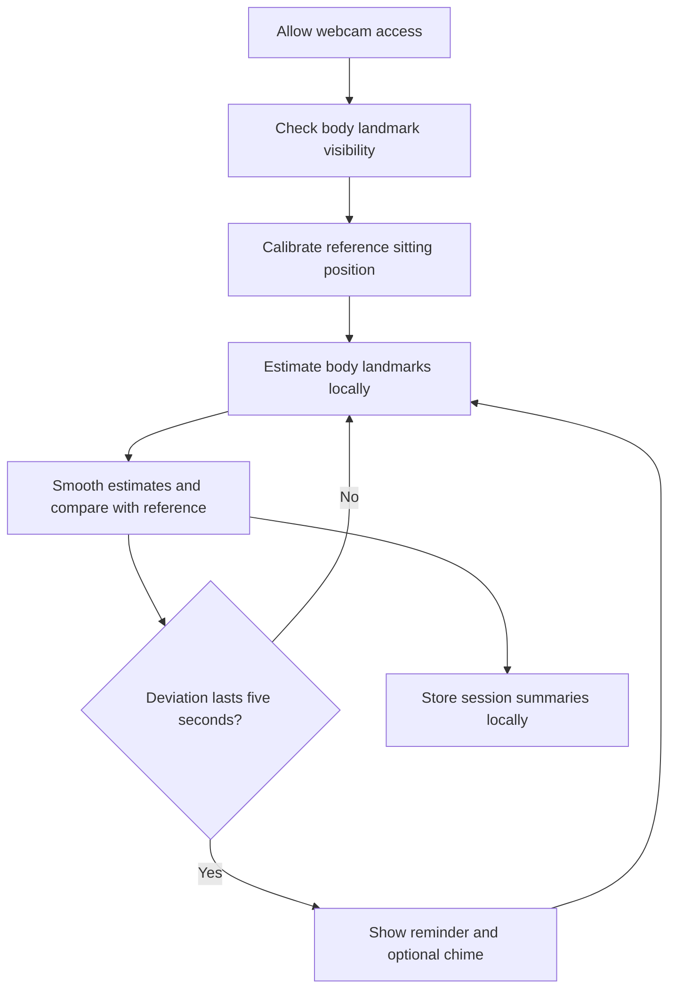

# PoseGuard

A browser-based posture awareness app designed to process laptop webcam images locally and give gentle reminders about sustained changes in sitting position.

**Status:** Planning stage. The features below describe the intended first version; camera reliability, performance, and offline behavior have not been validated yet.

## Why PoseGuard?

While working or studying, it is easy to stay in a shifted sitting position without noticing. PoseGuard aims to help users notice those changes through live visual feedback and optional sound reminders, while keeping camera images on their laptop.

## Planned Features

- Laptop webcam access with clear permission and camera states.
- Live body landmark and skeleton overlay.
- A short calibration step to establish the user's reference sitting position.
- Sustained head tilt relative to the shoulder line, compared with calibration.
- Sustained shoulder tilt relative to the image horizontal, compared with calibration. This measures visible alignment, not the cause or whole-body leaning.
- A reminder when a supported deviation persists for five continuous seconds, with an option to mute sound.
- Local session summaries showing time within and outside the configured posture range, with untracked time reported separately.
- CSV and JSON export of session summaries.
- Offline use after the app, model, and runtime have been successfully cached.

The MVP assumes one user facing a fixed laptop webcam. Head tilt uses the line between the ears relative to the shoulder line; shoulder tilt uses the line between the shoulders relative to the image horizontal. Both cues still require validation on the development laptop. Forward neck flexion, spinal slouch, and back curvature are outside the MVP pending separate testing.

## How It Works

A pretrained pose model estimates body points such as ears and shoulders. Simple geometry and explicit rules compare those points with the calibrated reference. The initial calibration target is about three seconds.

When required landmarks are not visible or confidence is too low, posture evaluation pauses and the reminder timer resets. Monitoring resumes when tracking is reliable again.

## Planned Tech Stack

- **Frontend — React + TypeScript:** interface and application logic.
- **Build tool — Vite:** local development server and static production build.
- **Webcam — Browser `getUserMedia`:** laptop camera access with user permission.
- **Pose estimation — MediaPipe Tasks Vision, Pose Landmarker Lite:** local CPU inference using `delegate: "CPU"`, with optional GPU acceleration on supported devices. A dedicated GPU is not required. [Supported delegates](https://github.com/google-ai-edge/mediapipe/blob/master/mediapipe/tasks/web/core/task_runner_options.d.ts).
- **Background processing — Web Worker + OffscreenCanvas:** frame processing and inference away from the interface thread, subject to browser compatibility testing.
- **Posture rules — TypeScript:** alignment calculations, smoothing, calibration comparisons, and reminder timing.
- **Visual feedback — Canvas 2D:** body landmarks and skeleton overlay.
- **Sound — Web Audio:** optional reminder chimes and mute control.
- **Local storage — IndexedDB:** session summaries and settings.
- **Offline support — Service worker + Cache Storage:** cached application, model, and runtime assets.
- **Testing — Vitest + Playwright:** posture rule unit tests and browser flow tests.
- **Deployment — Vercel static hosting:** serves the built application without an application backend.
- **Experimentation and evaluation — Python:** local landmark experiments and validation of posture calculations; not required on users' laptops.

No application backend, cloud database, LLM, or custom model training is planned for the first version. Python + FastAPI would be considered later only if features such as accounts or optional cross-device syncing require a backend.

### CPU Inference Plan

Start with Pose Landmarker Lite and target 10–15 posture checks per second, then adjust based on measurements on the development laptop. This is an initial target, not a verified performance claim.

Process one frame at a time and skip incoming frames while inference is busy to avoid a queue of stale frames. Camera preview and posture checking can run at different rates. Reminder timing uses elapsed time rather than a fixed number of frames; tracking loss or stale results must reset the timer.

## Intended Usage

1. Open the app and allow webcam access.
2. Adjust the camera so the required body parts are visible.
3. Sit comfortably upright and calibrate your reference position.
4. Start monitoring and receive reminders for sustained, supported changes.
5. End the session to review or export its summary.

Recalibrate after moving the camera or substantially changing your seating setup.

## Privacy and Limitations

The design calls for local frame processing, no recording or uploading of camera images, and storage of session summaries and settings only. No accounts or application backend are planned. Initial loading and updates require downloading the application and model assets from a static host.

Detection depends on camera angle, lighting, clothing, and body visibility. A laptop webcam may not show the hips or reliably distinguish forward slouching. Feedback describes deviation from a reference position; it is not a medical assessment or a validated health score.

Browser storage can be cleared or evicted. Offline availability, CPU performance, and optional GPU acceleration must be tested on the supported browsers and devices.

## Development and Validation

The first milestone is a fixed-camera experiment: calibrate while comfortably upright, hold a head tilt and then a shoulder tilt for six seconds each, returning to the reference between attempts. Repeat five times per cue, then test five minutes of ordinary typing, looking around, and brief reaching. Also test loss of required landmarks.

The initial engineering gate is at least four of five deliberate holds detected per cue, no reminders during the five-minute ordinary-work sample, and paused evaluation when required landmarks disappear. These are prototype criteria, not measured results or evidence of general accuracy. Angle thresholds, visibility cutoffs, and smoothing settings will be selected during the experiment and recorded with results.

See [PRD.md](PRD.md) for the MVP requirements and acceptance criteria.

Validation will cover landmark reliability, false reminders during ordinary movement, tracking loss, reminder timing, inference speed, interface responsiveness, offline reloads, and network checks for frame uploads. Performance figures will be published only after measurement on identified hardware and browsers.

Setup commands, test instructions, screenshots, and a deployed demo link will be added as the implementation becomes available.

## Build Progress

### Day 6 (Nov 8): MLflow tracking and Docker

- MLflow experiment tracking for the classifier (`experiments/model/tracking.py`): every training run logs its settings, scores, and trained model to a local file store, so runs can be compared instead of overwritten.
- Comparison on the Run 1 data: the random forest hit about 93% accuracy but detected 0 of 5 trials on both cues, it learned to always answer "upright". Accuracy lies on imbalanced data; F1 is the honest score. Neither model beats the rule baseline.
- Dockerized the FastAPI service (`Dockerfile`, `docker-compose.yml`): slim Python image, API on port 8000, MLflow UI on port 5000. Honest limit: Docker is not installed on the build machine, so the image was checked by tests, not by a real build.
- 70/70 tests passing in one combined run (33 eval + 37 model).

### Day 5 (Nov 7): scikit-learn classifier and FastAPI service

- Classifier per cue over 1-second windows of angle data (`experiments/model/`): logistic regression and a 200-tree random forest, grouped 5-fold cross-validation by trial. The shoulder classifier is forbidden from seeing the shoulder angle level, Day 4 proved that angle cannot tell a dropped shoulder from leaning at a desk.
- FastAPI service (`GET /health`, `POST /predict`) serving the trained models (`experiments/model/artifacts/`, about 2 KB each).
- Honest verdict: the classifier does not beat the rule baseline on either cue. Head caught 1/5 trials with 6 false positives; shoulder caught 5/5 but learned stillness, flagging 134 of 318 work windows. The fix is re-run data with longer, deeper holds, not a fancier model.
- 59/59 tests passing in one combined run (33 eval + 26 model).

### Day 4 (Nov 6): statistical validation

- Wilson confidence intervals, false-positive rates, and threshold/persistence curves (`experiments/eval/stats.py`).
- Verdicts: head tilt is salvageable, the tilts were real but too brief for the 5-second rule, so the re-run needs longer, deeper holds. Shoulder tilt is not a threshold problem, the metric itself is wrong for desk work, so Day 5 needs a different signal.
- 33/33 tests passing.

### Day 3 (Nov 5): evaluation harness

- Python eval package (`experiments/eval/`) with pandas: circular angle math, CSV loading, trial analysis, and a report generator, run against the real Nov 3 validation CSV.
- Findings: head tilt 0/5 at every threshold (longest hold above 5 degrees was 1.53s vs 5s required), shoulder tilt 0/5 with 7 false positives during ordinary work. Circular math removes the wraparound phantom deviations but does not fix the shoulder cue.
- 21/21 tests passing.

### Day 2 (Nov 4): camera pipeline

- Webcam access with permission states (prompt, granted, denied) and plain-English guidance for common failures such as denied access or no camera found.
- Frame capture in a Web Worker with OffscreenCanvas; one frame in flight at a time, frames dropped while busy, never queued.
- getUserMedia fallbacks: HD 1280x720, then SD 640x480, then any camera, with front-camera preference.
- FPS and frame-drop counters using elapsed-time timing, targeting about 15 checks per second.
- Minimal start/stop UI with permission state, error banner, and live FPS readout.
- 36/36 Vitest tests passing; type-check and production build clean.

### Day 1 (Nov 2): project scaffold and posture math

- Vite + React + TypeScript scaffold with the PRD folder structure.
- `src/posture/angles.ts`: pure functions for head-tilt and shoulder-tilt angle math plus EMA smoothing; 14/14 Vitest tests passing.
