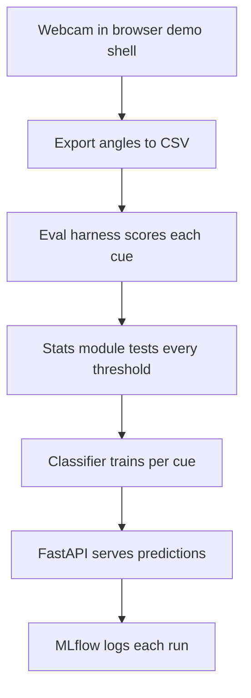

# PoseGuard

PoseGuard is a Python, AI, and ML project that tests whether webcam posture cues can be measured honestly. It collects real webcam landmark data, evaluates two posture cues against that data with pandas, validates them with statistics, trains scikit-learn and PyTorch classifiers on them, and serves the result behind FastAPI, with MLflow tracking and Docker packaging. A small React app acts as the demo shell that collects the webcam data in the first place.

The headline result is not a success story. The classifier does not beat the simple rule baseline on either cue yet, and the report below says exactly why. The value of the project is the evaluation: a full pipeline that can tell a real signal from a fake one, on real data, with numbers.

**Status:** Built through Day 10. The Python pipeline is complete and tested (99/99 tests). A PyTorch MLP benchmark (Day 8) confirmed no model beats the rule baseline yet. Day 9 made the API genuinely Render-deploy-ready (Blueprint, slim image, $PORT binding), verified by a live local smoke test; Day 10 made the same API AWS-deploy-ready (ECS Fargate, ECR, S3, load balancer), validated by tests. The live URL still needs his clicks on Render or AWS, and the Docker image has never been built for real because Docker is not installed on the build machine. The next step is a camera re-run with longer, deeper head holds, then a retrain on the new data.

## What this project is

Most posture apps start with the camera and the reminder. PoseGuard started there too, then the data took over. A validation run on a real laptop produced a CSV of about 7,820 frames, and everything since has been about what that CSV actually proves.

The pipeline, in order:

1. **Collect:** the React demo shell runs MediaPipe pose landmarks in the browser and exports the angles to CSV.
2. **Evaluate:** a pandas harness (`experiments/eval/`) scores each cue against the CSV, with circular angle math that handles the plus/minus 180 degree wraparound.
3. **Validate:** a statistics module (`experiments/eval/stats.py`) asks whether any threshold or persistence rule could make a cue pass, using Wilson confidence intervals, false-positive rates, and threshold/persistence curves.
4. **Learn:** a scikit-learn classifier (`experiments/model/`) trains one model per cue on 1-second windows of angle data, with grouped cross-validation by trial.
5. **Serve:** FastAPI (`GET /health`, `POST /predict`) serves the trained models.
6. **Track:** MLflow logs every training run to a local file store so runs can be compared instead of overwritten.
7. **Package:** a Dockerfile and docker-compose file wrap the API and the MLflow UI.

## The two cues, and the honest verdict

The MVP tracks two cues only. A reminder fires when a deviation persists for five continuous seconds, and the timer resets on tracking loss.

| Cue | What it measures | Verdict |
| --- | --- | --- |
| Head tilt | Angle of the ear line relative to the shoulder line, vs calibration | Salvageable. The tilts were real but too brief for the 5-second rule. The re-run needs longer, deeper holds. |
| Shoulder tilt | Angle of the shoulder line relative to the image horizontal, vs calibration | The metric is wrong for desk work. Leaning while typing looks identical to a dropped shoulder, and no threshold or persistence rule fixes it. Day 5 needs a different signal. |

The engineering gate is at least 4 of 5 deliberate holds detected per cue, with zero reminders during a five-minute ordinary-work sample. Neither cue passes it yet.

## Results on Run 1 (Nov 3, 2026)

Run 1 is one session on a real laptop: 5 head holds, 5 shoulder holds, about 5 minutes of ordinary desk work, and a landmark-loss test that never really ran (tracking was lost for only 18 of 1,828 frames). Baselines: head -5.6 degrees, shoulder 174.2 degrees. Full numbers are in [experiments/eval/REPORT.md](experiments/eval/REPORT.md); the plain-English walkthrough is in [experiments/eval/WALKTHROUGH.md](experiments/eval/WALKTHROUGH.md).

### Rule baseline (Day 3 and Day 4)

- Head tilt: **0/5 at every threshold (5, 6, 7, 8 degrees)**. Longest run above 5 degrees was 1.53s vs 5s required. Zero false positives.
- Shoulder tilt: **0/5 at every threshold, plus 7 false positives during ordinary work**, about 83 per hour of desk work.
- The wraparound bug was real and is fixed: the old linear math produced phantom deviations beyond 180 degrees in 1,188 shoulder frames. Circular math (`atan2(sin(a-b), cos(a-b))`) removes all of them, but it does not fix the shoulder cue.
- Wilson 95% interval on head detection (0/5) is 0 to 43%, far below the 80% gate. This is not bad luck on a small sample.

### Classifier (Day 5, out-of-fold, grouped 5-fold CV by trial)

The classifier does **not** beat the rule baseline on either cue. No decision threshold passes the gate (4/5 trials, 0 false positives) for either cue.

| Cue | Model | Accuracy | F1 (tilted) | Trials | False positives |
| --- | --- | --- | --- | --- | --- |
| Head | Logistic regression | 0.446 | 0.078 | 1/5 | 6 events |
| Shoulder | Logistic regression | 0.548 | 0.179 | 5/5 | 5 events, 134 of 318 work windows flagged |

The shoulder 5/5 is a stillness artifact. During holds you sit still; during work the tracker is noisy, so the model learned "steady equals tilted". On calm windows only, accuracy drops to about 0.45. The head model learned the relationship backwards: a flat upright window scores 0.56 tilted while a steady 6-degree tilt scores 0.33, because in Run 1 the biggest head deviations happened during noisy desk work, not during holds.

Root causes: one session, 23 tilted vs 360 upright windows, and protocol labels that are not ground truth (two of the five head holds barely tilted at all). The fix is re-run data, not a fancier model.

### MLflow comparison (Day 6)

| Run | Head trials | Shoulder trials | F1 head | F1 shoulder | Accuracy |
| --- | --- | --- | --- | --- | --- |
| Baseline (best model per cue) | 1/5 | 5/5 | 0.078 | 0.179 | 0.446 / 0.548 |
| Random forest only | 0/5 | 0/5 | 0.000 | 0.000 | about 0.93 |

The random forest hit about 93% accuracy by learning to always answer "upright". Accuracy lies on imbalanced data; F1 is the honest score. Neither model beats the rule baseline.

## How it works



The demo shell estimates body landmarks locally with a pretrained pose model (MediaPipe Pose Landmarker Lite, CPU delegate). Simple geometry compares those points with a calibrated reference position, about a 3-second calibration. When required landmarks are not visible or confidence is too low, posture evaluation pauses and the reminder timer resets.

Forward neck flexion, slouch, and medical assessment are out of scope. Feedback describes deviation from a reference position; it is not a medical assessment or a validated health score.

## Tech stack

**Python, data, and ML (the headline):**

- **Evaluation:** pandas, numpy, pytest. Circular angle math, CSV loading and schema validation, trial analysis, threshold sensitivity, Wilson intervals.
- **Modeling:** scikit-learn (logistic regression, 200-tree random forest), grouped cross-validation by trial, 1-second feature windows.
- **Serving:** FastAPI, uvicorn, joblib model artifacts (about 2 KB each).
- **Tracking:** MLflow, local file store.
- **Packaging:** Docker, docker-compose.

**Demo shell (React, not the headline):**

- **Frontend:** React 19 + TypeScript, Vite.
- **Pose estimation:** MediaPipe Tasks Vision, Pose Landmarker Lite, CPU delegate.
- **Camera:** browser `getUserMedia`, frame capture in a Web Worker with OffscreenCanvas, one frame in flight at a time.
- **Visual feedback:** Canvas 2D landmarks and skeleton overlay, Web Audio chimes, IndexedDB session summaries.

## Project layout

```
.
├── README.md
├── PRD.md                        # MVP requirements and acceptance criteria
├── experiments/
│   ├── eval/                     # Python eval harness (Days 3-4)
│   │   ├── circular.py           # wraparound-safe angle math
│   │   ├── loader.py             # CSV loading and schema validation
│   │   ├── analysis.py           # trial detection, false positives
│   │   ├── stats.py              # Wilson intervals, threshold/persistence curves
│   │   ├── report.py             # Markdown report generator
│   │   ├── cli.py                # python -m experiments.eval.cli
│   │   ├── REPORT.md             # full Run 1 numbers
│   │   └── WALKTHROUGH.md        # plain-English version
│   ├── model/                    # scikit-learn classifier + API (Days 5-6)
│   │   ├── features.py           # 1-second window features
│   │   ├── train.py              # per-cue training, grouped CV
│   │   ├── api.py                # FastAPI: GET /health, POST /predict
│   │   ├── tracking.py           # MLflow logging and comparison
│   │   ├── artifacts/            # trained models (model_head.joblib, model_shoulder.joblib)
│   │   ├── Dockerfile
│   │   └── docker-compose.yml    # API on 8000, MLflow UI on 5000
│   └── webcam-validation-experiment.html   # data collection page (serve locally, see below)
├── src/                          # React demo shell (Days 1-2)
│   ├── posture/angles.ts         # angle math and EMA smoothing
│   └── camera/                   # getUserMedia, worker capture, stats
└── docs/validation.md            # validation gate definition
```

## Setup and usage

### Python pipeline

Python 3.11 or later.

```bash
python3 -m venv ~/.venv-poseguard-eval
~/.venv-poseguard-eval/bin/pip install -r experiments/eval/requirements.txt
```

Run the eval harness on a validation CSV (from the repo root):

```bash
python -m experiments.eval.cli --csv <path/to/validation.csv>
python -m experiments.eval.cli --csv <path> --out experiments/eval/REPORT.md
```

It prints per-cue verdicts (PASS/FAIL vs 4/5 detections and zero false positives) plus the threshold sensitivity table, and writes the full Markdown report.

Train the classifier:

```bash
python -m experiments.model.train --csv <path/to/validation.csv>
python -m experiments.model.train --csv <path> --save
python -m experiments.model.train --csv <path> --model random_forest --mlflow --run-name random_forest_only
```

`--save` writes the winning model per cue to `experiments/model/artifacts/` and the full metrics to `results.json`. `--mlflow` logs the run to the local file store instead of overwriting `results.json`. Compare runs with `python -m experiments.model.tracking` (writes `mlflow_comparison.json`), or browse them with:

```bash
mlflow ui --backend-store-uri experiments/model/mlruns
```

Serve the API:

```bash
uvicorn experiments.model.api:app --port 8000
```

Run the tests (79/79 in one combined run: 33 eval + 37 model + 9 MLP):

```bash
python -m pytest experiments/ -q
```

### Docker

Build from the repo root (the build context):

```bash
docker build -f experiments/model/Dockerfile -t poseguard-api .
docker run -p 8000:8000 poseguard-api
```

Or run the API plus the MLflow UI together (from `experiments/model/`):

```bash
docker compose up --build
```

API on http://localhost:8000, MLflow UI on http://localhost:5000. The image already contains the trained models; mounting `./artifacts` over `/app/experiments/model/artifacts` serves a freshly retrained model without rebuilding.

Honest limit: Docker is not installed on the build machine, so the image was checked by tests, not by a real build. There is no live URL for the API yet.

### Demo shell (React)

```bash
npm install
npm test        # Vitest
npm run build   # type-check + production build
npm run dev     # Vite dev server
```

To collect validation data, serve `experiments/webcam-validation-experiment.html` from localhost, not from a hosted page, because the browser blocks camera access on hosted artifact pages. The working route is a local static server on port 8000, then open `http://localhost:8000/experiments/webcam-validation-experiment.html`. The page has adjustable thresholds (head default 8 degrees, shoulder default 6) and exports the session as CSV.

## Privacy and limitations

- All frame processing happens locally in the browser. No camera images are recorded or uploaded. Only angle numbers leave the page, as a CSV you export yourself.
- No accounts, no cloud database, no LLM in the loop.
- Detection depends on camera angle, lighting, clothing, and body visibility. A laptop webcam may not show the hips or reliably distinguish forward slouching.
- Everything above rests on one validation session (Run 1, Nov 3, 2026). One session, five holds per cue, is too little data to train on or to generalize from. The re-run is the next data point, not a victory lap.

## Build Progress

### Day 10 (Nov 12): AWS deploy prep

- ECS Fargate deploy prep in `deploy/aws/`: a task definition (`poseguard-api`, smallest Fargate size 0.25 vCPU / 0.5 GB, port 8000, health check on `/health`, CloudWatch logs), a service definition (desired count 1, behind an Application Load Balancer), and a deploy script that builds the same slim Day 9 image, pushes it to ECR, backs the trained model artifacts up to S3, registers the task definition, and creates or updates the service.
- Deploy guide (`docs/DEPLOY_AWS.md`): exact console steps and the deploy command, cost about $25 a month (about $9 for the task, about $16 for the load balancer), and the resume bullet this closes (AWS was the top skills gap, 11 postings).
- 99/99 tests passing in one combined run (33 eval + 66 model, including 12 new AWS tests). Still unverified: the deploy script has never been run end to end (no Docker on the build machine, no AWS account confirmed), and there is no live URL until the AWS steps run.

### Day 9 (Nov 10): Render deploy prep

- Render Blueprint (`render.yaml` at the repo root): one web service, `poseguard-api`, Docker runtime, free plan, health check on `/health`. No secrets needed, the image already contains the trained models and the API takes no API keys.
- Two real deploy blockers fixed in the Dockerfile: the start command now binds `$PORT`, which Render sets (10000 by default, not 8000), and the image now installs a slim runtime-only requirements file (`experiments/model/requirements-api.txt`), because the old file pulled torch and mlflow and the default torch install is the multi-gigabyte CUDA build. The MLflow service in docker-compose still gets the full requirements through a build arg.
- Deploy guide (`docs/DEPLOY.md`): exact click-by-click Render steps, free-tier notes, and a manual fallback.
- Verified live locally: the API started on a Render-style port with uvicorn, `/health` answered 200 with both models loaded, `/predict` answered 200 for both cues, and a bad cue answered 422.
- 87/87 tests passing in one combined run (33 eval + 54 model, including 9 MLP, 8 Docker, 5 Render). Still unverified: no real Docker build has ever run, Docker is not installed on the build machine, and there is no live URL until the Render steps run.

### Day 8 (Nov 10): PyTorch MLP benchmark

- Small PyTorch MLP per cue (`experiments/model/torch_mlp.py`): two hidden layers (32, 16), ReLU, dropout, Adam with weight decay, early stopping on a validation split taken from the training groups only, inverse-frequency class weights computed from the training portion only. CPU-only, deterministic at a fixed seed. Torch 2.15.0+cpu installed in the eval venv.
- Benchmark (`experiments/model/benchmark.py`, `BENCHMARK.md`): MLP vs logistic regression vs random forest on the same Run 1 data, same grouped 5-fold CV by trial. Honest verdict: the MLP does not beat logistic regression on either cue (head F1 0.060 vs 0.078, shoulder 0.133 vs 0.179) and passes the gate on neither (head 1/5 trials, 4 FP; shoulder 2/5 trials, 1 FP). It is the least trigger-happy model and the only one whose signal survives the calm-only check (accuracy 0.685/0.663 vs 0.427/0.447). At threshold 0.3 the head MLP reaches 4/5 trials with 2 FP, the closest any model has come to the gate. The fix is still the re-run data, not a fancier model.
- 79/79 tests passing in one combined run (33 eval + 37 model + 9 MLP).

### Day 7 (Nov 9): README rewritten around the data and ML story

- The root README now leads with the Python evaluation pipeline, the statistical validation, and the classifier, with the React frontend moved to a demo-shell section.
- All results are stated with the honest verdicts: the classifier does not beat the rule baseline on either cue, head tilt is salvageable with a re-run, and the shoulder metric is wrong for desk work.
- Added setup and usage for the full pipeline: eval CLI, training flags, MLflow tracking, API serving, and Docker, plus the honest note that the Docker image was never built for real.

### Day 6 (Nov 8): MLflow tracking and Docker

- MLflow experiment tracking for the classifier (`experiments/model/tracking.py`): every training run logs its settings, scores, and trained model to a local file store, so runs can be compared instead of overwritten.
- Comparison on the Run 1 data: the random forest hit about 93% accuracy but detected 0 of 5 trials on both cues, it learned to always answer "upright". Accuracy lies on imbalanced data; F1 is the honest score. Neither model beats the rule baseline.
- Dockerized the FastAPI service (`Dockerfile`, `docker-compose.yml`): slim Python image, API on port 8000, MLflow UI on port 5000. Honest limit: Docker is not installed on the build machine, so the image was checked by tests, not by a real build.
- 70/70 tests passing in one combined run (33 eval + 37 model).

### Day 5 (Nov 7): scikit-learn classifier and FastAPI service

- Classifier per cue over 1-second windows of angle data (`experiments/model/`): logistic regression and a 200-tree random forest, grouped 5-fold cross-validation by trial. The shoulder classifier is forbidden from seeing the shoulder angle level, Day 4 proved that angle cannot tell a dropped shoulder from leaning at a desk.
- FastAPI service (`GET /health`, `POST /predict`) serving the trained models (`experiments/model/artifacts/`, about 2 KB each).
- Honest verdict: the classifier does not beat the rule baseline on either cue. Head caught 1/5 trials with 6 false positives; shoulder caught 5/5 but learned stillness, flagging 134 of 318 work windows. The fix is re-run data with longer, deeper holds, not a fancier model.
- 59/59 tests passing in one combined run (33 eval + 26 model).

### Day 4 (Nov 6): statistical validation

- Wilson confidence intervals, false-positive rates, and threshold/persistence curves (`experiments/eval/stats.py`).
- Verdicts: head tilt is salvageable, the tilts were real but too brief for the 5-second rule, so the re-run needs longer, deeper holds. Shoulder tilt is not a threshold problem, the metric itself is wrong for desk work, so Day 5 needs a different signal.
- 33/33 tests passing.

### Day 3 (Nov 5): evaluation harness

- Python eval package (`experiments/eval/`) with pandas: circular angle math, CSV loading, trial analysis, and a report generator, run against the real Nov 3 validation CSV.
- Findings: head tilt 0/5 at every threshold (longest hold above 5 degrees was 1.53s vs 5s required), shoulder tilt 0/5 with 7 false positives during ordinary work. Circular math removes the wraparound phantom deviations but does not fix the shoulder cue.
- 21/21 tests passing.

### Day 2 (Nov 4): camera pipeline

- Webcam access with permission states (prompt, granted, denied) and plain-English guidance for common failures such as denied access or no camera found.
- Frame capture in a Web Worker with OffscreenCanvas; one frame in flight at a time, frames dropped while busy, never queued.
- getUserMedia fallbacks: HD 1280x720, then SD 640x480, then any camera, with front-camera preference.
- FPS and frame-drop counters using elapsed-time timing, targeting about 15 checks per second.
- Minimal start/stop UI with permission state, error banner, and live FPS readout.
- 36/36 Vitest tests passing; type-check and production build clean.

### Day 1 (Nov 2): project scaffold and posture math

- Vite + React + TypeScript scaffold with the PRD folder structure.
- `src/posture/angles.ts`: pure functions for head-tilt and shoulder-tilt angle math plus EMA smoothing; 14/14 Vitest tests passing.

## What comes next

1. **Camera re-run:** longer, deeper head holds (head threshold 5), all 10 trials plus a 5-minute work sample and a landmark-loss test with the camera covered. Serve the updated experiment page from localhost.
2. **Retrain on the re-run data:** run the eval harness, then retrain the classifier and compare the new run in MLflow.
3. **A different signal for the shoulder cue:** the angle level cannot separate a dropped shoulder from leaning at a desk. Candidates are movement-based features or a different landmark pair.
4. **Live deploy of the API:** Day 9 made the repo Render-ready (Blueprint, slim image, $PORT binding) and wrote the click-by-click guide in `docs/DEPLOY.md`. The live URL still needs his Render clicks; once it exists it goes into this README. No live URL until then.
